 

<a href="https://github.com/Jawad-Official/EcoLens">EcoLens</a> ·
<a href="https://github.com/Jawad-Official/Astrozen">Astrozen</a> ·
<a href="https://github.com/Jawad-Official/De-Board">De-Board</a> ·
<a href="https://github.com/Jawad-Official/writing-toolkit-skills">writing-toolkit-skills</a>
 
Every card is rendered from the GitHub API by <a href="scripts/generate.py">scripts/generate.py</a> and refreshed daily.

