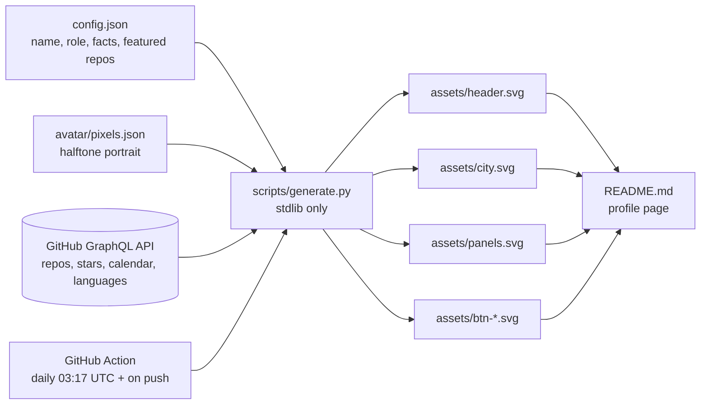

# Profile dashboard setup

Everything in this folder becomes the root of a new repository named exactly `Jawad-Official`. GitHub shows that repository's `README.md` on your profile page.



## 1. Create the repository

1. Go to https://github.com/new.
2. Name it `Jawad-Official` (must match your username). Public. No template files.
3. GitHub shows a "special repository" notice. That confirms it.

## 2. Copy this folder in

```bash
git clone https://github.com/Jawad-Official/Jawad-Official.git
```

```bash
cp -r github-profile/. Jawad-Official/
```

```bash
cd Jawad-Official && git add -A && git commit -m "feat: profile dashboard" && git push
```

The push triggers the workflow, which replaces the sample numbers in `assets/*.svg` with your live data within about a minute.

## 3. Allow the Action to push

Repository Settings, Actions, General, Workflow permissions: select **Read and write permissions**. Save.

Then run it once by hand: Actions tab, "Update profile dashboard", **Run workflow**.

## 4. Optional: count private contributions

The default `GITHUB_TOKEN` only sees public activity.

1. Create a classic personal access token with the `read:user` scope.
2. Add it as a repository secret named `PROFILE_TOKEN`.
3. On your profile, enable "Include private contributions on my profile".

## Customise

| What | Where |
| --- | --- |
| Name, role, tagline, facts, stack line | `config.json` |
| Selected work (up to 4 public repos), descriptions, tags | `config.json` `featured` |
| Repos left out of the stats | `config.json` `exclude_repos` |
| Link buttons | `config.json` `links` and `README.md` |
| Languages to hide (HTML, CSS, ...) | `config.json` `exclude_languages` |
| Colours | constants at the top of `scripts/generate.py` |
| Avatar | see below |

## Avatar

The header portrait is an LED dot matrix (72 x 86). Only the figure is lit; the frame stays dark, with small stars and sparkles drifting slowly behind it. It fades in and blinks every few seconds.

`avatar/portrait.png` is the cut-out source picture. `scripts/make_avatar.py` turns it into `avatar/pixels.json`, which the header reads.

Re-run after changing the picture:

```bash
python scripts/make_avatar.py
```

Use a different picture:

```bash
pip install pillow
```

```bash
python scripts/make_avatar.py path/to/image.png --remove-bg --eyes 0.38,0.41,0.57,0.41
```

- `--remove-bg` removes a white or checkerboard background by flood-filling from the edges, crops around the head and saves the result as `avatar/portrait.png`.
- `--eyes` is optional: the x,y of each eye centre as fractions of the cropped picture, used for the blink.
- `--style dots` (default) suits pixel and dot art, `photo` suits photos, `flat` suits flat illustrations.

Commit `avatar/portrait.png` and `avatar/pixels.json`; the Action re-renders the header.

## Spacing

Every card follows one grid, set at the top of `scripts/generate.py`:

| Constant | Meaning |
| --- | --- |
| `GAP` | space between neighbouring cards and link buttons (~10 px on GitHub) |
| `PAD` | transparent margin above and below each card; controls the vertical gap |
| `IN_L`, `IN_R` | inner content edges shared by every card (30 px padding) |

## Preview locally

```bash
python scripts/generate.py --demo
```

Renders with sample data, no token needed, into `preview/` (git-ignored). Sample numbers never touch `assets/`, so they cannot reach your profile.

With live data:

```bash
GH_TOKEN=<your token> python scripts/generate.py
```
